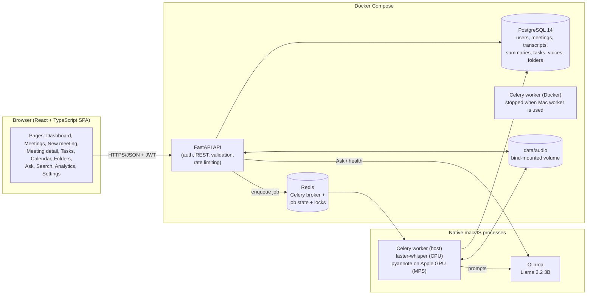

# Meeting Intelligence Agent — Complete Project Summary

> Purpose of this file: a full, self-contained description of the project, written so it can be pasted into ChatGPT (or any
> assistant) to produce a project **report** and a **PowerPoint presentation**. Section 17 suggests a report outline, a slide
> outline and ready-to-use prompts.

---

## 1. One-paragraph overview

**Meeting Intelligence Agent** is a locally-run web application that turns a meeting **audio recording** into structured
knowledge. A user uploads or records a meeting; the system transcribes the speech, works out **who said what** (speaker
identification, including recognising registered team members by their saved voice), writes an **executive summary** with key
points, decisions and next steps, extracts **action items** (task, owner, deadline, priority), and puts the deadlines on an
**internal calendar**. Users can then search across meetings, **ask questions in plain English** about their meetings, group
meetings into **folders that remember earlier meetings**, track tasks, and see analytics. All AI runs **on the user's own
computer** (open-source models, no paid APIs, no audio or text sent to the cloud).

- **Domain:** Natural Language Processing (speech recognition, summarisation, information extraction, question answering) +
  speaker biometrics + full-stack web engineering.
- **Deployment scope:** local use only (not a public service). Everything runs on one Mac; data stays on that machine.
- **Trial:** tested with a 20-member group; each member has an account and a saved voice.

---

## 2. Problem statement and objectives

**Problem.** Meetings produce decisions and commitments that are quickly forgotten. Manual minute-taking is slow, inconsistent,
and rarely links "who promised what, by when" to a calendar. Existing cloud tools (Otter, Fireflies, etc.) are paid and send
confidential audio to third parties.

**Objectives.**
1. Convert raw meeting audio into an accurate, speaker-labelled transcript.
2. Produce a faithful summary (key points, decisions, next steps, verbatim quotes) without inventing content.
3. Extract action items with owner, deadline phrase, resolved date and priority.
4. Recognise people automatically from saved voices, so nobody has to type attendees' e-mails.
5. Give every user their own private view: tasks assigned to them, notifications, calendar, analytics.
6. Let a series of meetings share memory (Meeting 3 knows Meetings 1 and 2).
7. Keep everything **local, free and private**.

---

## 3. Technology stack

| Layer | Technology | Role |
|---|---|---|
| Speech-to-text | **faster-whisper** (Whisper "base", int8) | Transcription with word timestamps and VAD |
| Speaker diarization | **pyannote.audio 3.1** (`speaker-diarization-3.1`) | "Who spoke when" + 256-dim voice embeddings |
| Voice recognition | Cosine similarity over embeddings (own code) | Match speakers to registered members |
| LLM | **Llama 3.2 3B** via **Ollama** (temperature 0) | Summary, action items, follow-up, Q&A |
| API | **FastAPI** + Pydantic v2 + Uvicorn | REST backend (~77 routes) |
| Background jobs | **Celery** + **Redis** | Long-running processing pipeline, job state, locks |
| Database | **PostgreSQL 14** via **SQLAlchemy 2** | Users, meetings, transcripts, summaries, tasks, voices, folders |
| Frontend | **React 18 + TypeScript + Vite**, react-router 6 | Single-page app |
| Frontend tests | **Vitest** (+ Playwright e2e) | 409 unit/component tests |
| Backend tests | **pytest** | 625+ tests (9 skipped integration tests) |
| Packaging | **Docker Compose** (api, worker, postgres, redis) + native Mac worker | Reproducible local stack |
| GPU | PyTorch **MPS** (Apple M-series GPU) | Speeds up speaker analysis |
| Audio tools | ffmpeg, pydub, librosa | Decoding / conversion |
| Auth | scrypt password hashes, HS256 JWT access tokens, rotating refresh tokens | Accounts and sessions |
| Calendar export | iCalendar `.ics` generation | One-way export |

Hardware used: Apple M3, 8 cores, 16 GB RAM; Docker VM 8 CPU / 7.7 GB.

---

## 4. System architecture

### 4.1 Component diagram (Mermaid — paste into a Mermaid renderer)



### 4.2 ASCII version (for slides that cannot render Mermaid)

```
 ┌────────────────────┐        JSON + JWT        ┌──────────────────────────┐
 │  Browser (React)   │ ───────────────────────► │  FastAPI backend         │
 │  Dashboard, Tasks, │ ◄─────────────────────── │  auth • REST • limits    │
 │  Calendar, Ask ... │                          └───────┬──────────┬───────┘
 └────────────────────┘                                  │          │ enqueue
                                                         ▼          ▼
                                              ┌────────────────┐ ┌──────────┐
                                              │ PostgreSQL 14  │ │  Redis   │
                                              │ all app data   │ │ broker + │
                                              └───────▲────────┘ │ job state│
                                                      │          └────┬─────┘
                                                      │               ▼
                        ┌─────────────────────────────┴──────────────────────┐
                        │  Celery worker (runs natively on the Mac)          │
                        │   1 Transcribe (faster-whisper)  ┐ run at the      │
                        │   1 Speaker analysis (pyannote,  ┘ same time       │
                        │     Apple GPU)                                     │
                        │   2 Summarise      ─┐                              │
                        │   3 Extract tasks  ─┴─► Ollama (Llama 3.2 3B)      │
                        └────────────────────────────────────────────────────┘
```

### 4.3 Why the worker runs on the Mac, not in Docker
Docker on macOS runs inside a Linux VM and **cannot use the Apple GPU**. The processing worker therefore runs natively on the
Mac (`make host-worker`) so pyannote can use **MPS**. The API, PostgreSQL and Redis stay in Docker. Audio files live in a
bind-mounted folder (`./data/audio`) that both sides can read; database paths are stored in container form (`/data/audio/...`)
and translated to host paths by `audio_storage.local_path/canonical_path`.

### 4.4 Source layout
```
src/
  api/main.py            FastAPI app, ~77 endpoints
  agent/                 AI agents: transcriber, summarizer, action_extractor, qa, scheduler
  services/              business logic: auth, pipeline, voices, folders, ask, search, analytics,
                         internal_calendar, scheduling, recurrence, notifications, reminders,
                         assignments, task_thread, transcript_edit, ical, mailer, audio_storage
  workers/               Celery tasks + Redis job state
  models/                SQLAlchemy models, Pydantic schemas, DB init/migrations
frontend/src/            React app (pages, components, api client, lib helpers)
scripts/host_worker.py   launcher for the native Mac worker
tests/                   pytest suite; frontend/tests has Vitest suite
```

---

## 5. The processing pipeline (core workflow)

A meeting moves through these states: *scheduled → recorded/uploaded → processing → processed* (or failed/retrying).
Processing is one **job** with three idempotent steps (a retried job skips steps already finished). A per-meeting Redis lock
prevents two jobs processing the same meeting.

```
 Audio file
    │
    ▼
 ① TRANSCRIBE & IDENTIFY SPEAKERS ─────────────────────────────────────────────
    ├─ faster-whisper "base": text + word timestamps (VAD removes silence)   ┐ concurrent
    ├─ pyannote 3.1 diarization: speaker turns + one 256-d embedding/speaker ┘ threads
    ├─ turn-by-turn voice matching against every saved member voice
    ├─ words assigned to speakers by time overlap; segments split at speaker changes
    └─ clusters matched to saved voices → "Speaker 3" becomes "Jai Jain"
    ▼
 ② WRITE SUMMARY (Ollama, Llama 3.2 3B) ───────────────────────────────────────
    ├─ long transcripts are condensed in chunks first
    ├─ call A: executive summary (free text)
    ├─ call B: structured JSON (key points, decisions, next steps, quotes)
    ├─ quotes are validated to appear verbatim in the transcript
    └─ if the meeting is in a folder: call C "follow-up" using the earlier meetings' memory
    ▼
 ③ EXTRACT ACTION ITEMS (Ollama, JSON-schema constrained) ─────────────────────
    ├─ task, assignee, deadline phrase (copied as spoken), priority
    ├─ relative deadlines ("by Friday") resolved against the meeting date in code, never by the LLM
    └─ regex/pattern fallback if the model is unavailable
    ▼
 Saved to PostgreSQL → notifications sent → tasks/deadlines appear on the internal calendar
```

**Timing (real 3 min 36 s, 20-person recording):** originally >11 minutes on Docker CPU (unfinished); now **≈157 s** total on
the Mac — speaker analysis 51 s on GPU and Whisper 38 s running concurrently, then LLM summary ≈40 s and task extraction
≈60 s (the LLM is now most of the time).

---

## 6. Key algorithms and design decisions

### 6.1 Transcription
faster-whisper (CTranslate2) "base" model, int8 on CPU, word timestamps, VAD filter. Converted to `confidence` per segment from
average log-probability. Speech-to-text runs **in parallel** with diarization in a thread pool (both release the GIL).

### 6.2 Speaker diarization and voice embeddings
pyannote 3.1 returns turns (`start`, `end`, `SPEAKER_xx`) and one centroid embedding per speaker. Transcript words are assigned
to the speaker with the greatest time overlap; a Whisper segment that spans a speaker change is split at the change.
Runs on **Apple MPS** with automatic fallback to CPU if a GPU operation fails.

### 6.3 Voice recognition (who is this?)
- Every member records or imports ~15 s of speech at sign-up; the embedding is stored as a **VoiceProfile** under their e-mail.
- **Matching = cosine similarity** between the speaker embedding and every saved sample.
  - ≥ 0.60 → named automatically.
  - 0.50–0.60 → "Is this X?" (user confirms).
  - Each person and each speaker is used at most once (best pairs first).
- Recognised people are **automatically added to the meeting's participants** (their e-mail is looked up from the directory), so
  they can sign in and see the meeting and their tasks — nobody types e-mails.
- A **correction** option lets the user rename a wrongly matched speaker (name + e-mail); optionally revoke the previously
  granted access.
- `VOICE_MATCH_SCOPE=all` (default) checks all members; `participants` restricts to listed people.
- **Turn-by-turn matching (added later).** The diarizer merges voices that sound alike (in a 20-person meeting it produced only
  9 speakers). So each speaking turn (≥1.2 s) also gets its own embedding and is compared with all saved voices. A clear match
  names that turn directly. Because some voices (with several samples) score high against everyone, scores are **z-normalised
  per person across the recording's turns** (when ≥8 turns), with a minimum raw score of 0.5 and a margin over the runner-up.
  On the real 20-person recording this raised recognised speakers from 9 groups to 26 labels, with 17 of 20 saved voices matched.
- Short samples are accepted (≥ ~4 s of audio; ≥ 1.5 s of detected speech) but longer samples are more reliable.

### 6.4 Summarisation (LLM, local)
Llama 3.2 3B at temperature 0. Structured output uses an Ollama **JSON schema** (`format`) so the model must return valid
fields. Hallucination controls: "use only the transcript", verbatim-quote validation, empty lists allowed. Robustness fixes:
repeat-penalty, answer-length caps, **salvaging truncated JSON** (keep every complete item), one shorter retry.

### 6.5 Action-item extraction
Schema-constrained JSON array: `task, assignee, due_date_phrase, priority`. The model **copies the deadline phrase**; a
deterministic resolver converts phrases like "by Friday", "next Monday", "tomorrow" into dates using the meeting's date.
Assignees are matched to users by comparing with the user's first name/e-mail. Truncated output keeps complete items.

### 6.6 Folders with memory (new feature)
A user creates a **folder** (e.g. "Project X") when uploading. Meetings in a folder are numbered by date (Meeting 1, 2, 3 …).
When Meeting N is processed, the system builds a **memory text** from the previous meetings — their summaries (≤450 chars),
decisions, and still-open tasks, fitted to 4,000 characters (oldest dropped first) — and a separate LLM call writes a
**follow-up** (how this meeting continues earlier ones, what changed, what is still open). The follow-up is stored with the
summary and shown on a card. The **Ask** feature can also be scoped to a folder. A folder never changes a meeting's own summary.
The UI warns that the follow-up "can be wrong".

### 6.7 Ask (question answering over meetings)
Retrieval-augmented generation without a vector DB: only meetings the user may read are searched; the relevant ones are chosen
by the words of the question, then by recency; a compact context (summary, tasks, key transcript lines) tagged `[M1]`, `[M2]`…
is capped to fit the model window. The model must answer only from that context, cite sources, and admit when the answer is not
there. Conversation history is stored per user (and per folder).

### 6.8 Search
Full-text across titles, summaries, tasks and transcript lines; all query words must appear in the same piece of text;
`"quoted phrases"` match exactly.

### 6.9 Internal calendar & scheduling
The calendar is **internal**: built only from the app's PostgreSQL data (scheduled/started/recorded meetings + action-item
deadlines). No Google/Microsoft calendar is integrated. Features: conflict detection, free-slot finder ("find optimal time"),
calendar health, recurring meetings (daily, weekdays, weekly, biweekly, monthly; up to 52 occurrences; wall-clock times kept in
the meeting's time zone), reminders (30 min before meetings, "due today/tomorrow" for tasks; deduplicated), and **one-way
`.ics` export** to import into any calendar app.

### 6.10 Tasks and assignments
Assignee text is matched to the signed-in user. Only the assignee may change a task's status; the meeting owner may for
unclaimed tasks; admins for any. Tasks support comment threads and **deadline-extension requests** (request → owner decision).

### 6.11 Analytics
Who talks how much, task completion by person, week-over-week comparison; only meetings the user can read are counted.

### 6.12 Transcript editing
Fix a single segment, or replace a misheard word everywhere (transcript, summary, tasks); edited segments are flagged.

---

## 7. Data model (PostgreSQL)

| Table | Important fields |
|---|---|
| `users` | id, email, name, password hash (scrypt), is_active, timezone, email_notifications |
| `auth_sessions`, `refresh_tokens`, `password_reset_tokens` | per-device sessions, rotating refresh tokens, reset flow |
| `meetings` | id, title, status, owner_email, participants[], scheduled_time, started_at, duration, audio_file_path, recurrence, `folder_id` |
| `folders` | id, owner_id, name, name_key (case-insensitive unique per owner), created_at |
| `transcripts` | meeting_id, language, full_text, segments (JSON: speaker, start, end, text, confidence), word_count, speaker_count, `speaker_voices` (embeddings) |
| `summaries` | meeting_id, executive_summary, key_points, decisions, next_steps, key_quotes, `follow_up` |
| `action_items` | meeting_id, task, assignee, due_date (+ phrase), priority, status |
| `voice_profiles` | owner_id, display_name, email, embeddings[] (up to several samples) |
| `notifications`, `task_comments`, `ask_history` | in-app notifications, task threads, saved Q&A (with `folder_id`) |
| `calendar_accounts` | (optional external-calendar OAuth, disabled in local mode) |

Schema changes are applied by `init_db` (`create_all` + `ALTER TABLE … ADD COLUMN IF NOT EXISTS`). Job state (not results) is
kept in Redis for 7 days.

---

## 8. Backend API (selected, ~77 routes)

- **Auth:** `POST /auth/register|login|refresh|logout|logout-all|change-password|forgot-password|reset-password`, `GET /auth/me`, `GET /auth/sessions`.
- **Meetings:** `POST /api/v1/meetings/upload|schedule|start`, `GET /meetings`, `GET|PUT|DELETE /meetings/{id}`, `/cancel`, `/end`, `/series`, `/audio`, `/process` (starts the job), `GET /jobs/{id}`, `/meetings/{id}/jobs/latest`.
- **Content:** `/meetings/{id}/transcript`, `/summary`, `/actions` (CRUD + status), transcript edits (`PATCH …/segments/{id}`, `POST …/transcript/replace`).
- **Speakers & voices:** `GET|PUT /meetings/{id}/speakers`, `POST …/speakers/analyze`, `GET /voice-profiles`, `POST /voice-profiles/me`, `PATCH|DELETE /voice-profiles/{id}`, `GET /people` (member directory for the participants dropdown).
- **Folders:** `GET|POST /folders`, `GET|PATCH|DELETE /folders/{id}`, `PUT /meetings/{id}/folder`.
- **Intelligence:** `POST /ask`, `GET|DELETE /ask/history`, `GET /search`, `GET /analytics`.
- **Calendar:** `GET /export/calendar.ics`, `/meetings/{id}/calendar.ics`, `POST /calendar/find-optimal-time`, `GET /calendar/{user}/health|events`.
- **Other:** notifications, task threads/extension requests, `POST /meetings/{id}/send-summary` (e-mail), `/health`, `/health/ready` (checks database, Redis, Ollama).

---

## 9. Frontend (React + TypeScript)

**Pages:** Login/Register (voice setup required), Dashboard, Meetings (with folder filter), New meeting (upload, record in
browser, schedule, pick/create folder, participants dropdown), Meeting detail (Summary, Transcript with speaker panel and audio
clips, Action items, Details; processing progress card), Tasks, Calendar, Folders and Folder detail (numbered timeline),
Ask, Search, Analytics, Settings (profile, time zone, **My voice**, saved voices, password, devices).

**Notable UI features**
- Browser **voice recorder** (pause/resume, live level meter) **and import-from-device** for audio files.
- **Participants box with dropdown** of registered members' e-mails (autocomplete) — no need to remember e-mails.
- **Speaker panel:** "Sounds like X (58% match) — is this right?" with **3 audio clips of that speaker** so the user can listen before naming; correction dialog (name + e-mail, revoke old access).
- Live **processing progress** (three step cards, retry state, errors).
- Per-tab sessions (sessionStorage) with Web-Locks-protected token refresh and a timeout fallback (fixed a stuck "Restoring your session…" screen).
- Dark theme, responsive, keyboard-accessible.

---

## 10. Security and privacy

- Fully local: audio, transcripts and models never leave the machine; no paid or cloud AI APIs.
- Passwords hashed with **scrypt** + per-user salt; short-lived **HS256 JWT** access tokens (15 min) + rotating refresh tokens (14 days); per-device sessions with sign-out-everywhere; password-reset tokens.
- Authorisation by ownership: owner/admin full access, listed participants read access; folders are private (others see "not found"); assignee-only task status changes.
- **Rate limiting** on expensive endpoints, registration and refresh; upload validation (extension whitelist, size limits, filename sanitising); CORS configurable; API docs can be disabled; secrets only in `.env` (never committed).
- The app refuses to start without a strong `JWT_SECRET`.

---

## 11. Testing and quality

- **Backend:** pytest — 625 passed, 9 skipped (integration tests needing live services) covering auth, sessions, security, API flows, voices and matching, transcriber (concurrency, GPU/CPU fallback), summarizer, action extraction, folders (39 tests), search, analytics, scheduling, recurrence, calendar, notifications, exports, Celery pipeline.
- **Frontend:** Vitest — 409 tests; plus Playwright end-to-end scripts; TypeScript type-check and production build are clean.
- Tests for the newest changes: turn-by-turn matching of merged speakers, JSON salvage of truncated model output, voice requirement at registration.

---

## 12. Results and observations

| Measure | Result |
|---|---|
| Processing time, 3 m 36 s meeting | >11 min (CPU Docker) → ≈157 s (native worker + GPU + concurrency) |
| Speaker recognition, 20-person recording (earlier test) | 19 of 20 people named correctly |
| Hard 20-person, 3m27s recording (1–2 sentences each) | diarizer alone found 9 speakers; with turn matching 26 labels / 17 of 20 voices matched |
| Summary + 5 decisions + tasks | generated locally; structured-extraction step ≈45 s after fixes |
| Voice enrolment | works with ≈4 s samples (longer = more reliable) |

---

## 13. Challenges faced and how they were solved

1. **Slow processing** → run diarization and Whisper concurrently; move the worker to the Mac for MPS GPU.
2. **Docker cannot use Mac GPU** → hybrid design (API/DB/Redis in Docker, worker native) with shared audio folder and path mapping.
3. **Small LLM returns broken JSON / rambles until the token limit** → JSON-schema output, repeat penalty, length caps, salvage of truncated JSON, one shorter retry, longer timeout.
4. **Diarizer merges similar voices** (20 people → 9 speakers) → per-turn matching to saved voices with per-person score normalisation.
5. **Entering attendees' e-mails does not scale** → automatic recognition → automatic e-mail addition + member dropdown + correction UI.
6. **Unsure who "Speaker 18" is** → play that speaker's audio clips before naming.
7. **"Restoring session" hang** (Web Lock held by a frozen tab) → lock and fetch timeouts with fallback.
8. **LLM hallucination risk** → temperature 0, "only from the transcript", quote validation, deterministic date resolution, UI disclaimers.

---

## 13. Limitations (be honest in the report)

- Whisper "base" and a 3B LLM favour speed/local use over best accuracy; names may be misheard and tasks occasionally missed or misattributed.
- Very short turns (< ~1 s) and overlapping speech cannot be reliably identified; those stay "Speaker N" for manual naming.
- Speaker recognition quality depends on sample quality and how similar voices are (e.g. two similar voices can merge or be confused).
- Folder "follow-up" memory is only as good as the earlier summaries; the model can misattribute.
- Calendar is internal; export is one-way `.ics` (no Google/Outlook sync). E-mail notifications need SMTP configuration.
- Built for local, single-machine use (no multi-server scaling, TLS or public hardening by default).
- English-focused.

## 14. Future work
Larger Whisper model / faster GPU inference, better LLM (e.g. larger local model), user-supplied "number of speakers" hint,
two-way calendar sync, live (real-time) transcription, mobile app, multilingual support, SMTP/e-mail digests, CI pipeline,
vector-search retrieval for Ask.

---

## 15. How to run (local)

```
docker compose up -d            # api + postgres + redis (docker worker kept stopped)
make host-worker                # native Mac worker (GPU) — keep running
cd frontend && npm run dev -- --host 127.0.0.1 --port 5174
ollama serve   # with llama3.2 pulled
```
Open http://127.0.0.1:5174, register (record or import your voice), upload or record a meeting, press **Process recording**.
Health check: `curl localhost:8000/health/ready` (database, Redis, Ollama).

## 16. Configuration highlights (environment)
`OLLAMA_HOST/MODEL`, `WHISPER_MODEL/DEVICE/COMPUTE_TYPE`, `HF_TOKEN` (pyannote model access), `DIARIZATION_DEVICE`,
`VOICE_MATCH_THRESHOLD` (0.6), `VOICE_CONFIRM_MIN` (0.5), `VOICE_MATCH_SCOPE`, `TURN_MATCH_MIN`, `JWT_SECRET`, `ADMIN_EMAILS`,
`ACCESS_TOKEN_MINUTES`, `REFRESH_TOKEN_DAYS`, `ALLOW_REGISTRATION`, rate-limit variables, `EMAIL_ENABLED` + SMTP settings.

---

## 17. Material to give ChatGPT

### 17.1 Suggested report outline
1. Abstract  2. Introduction & motivation  3. Problem statement & objectives  4. Literature/tool survey (Whisper, pyannote, LLMs, commercial tools)  5. System architecture  6. Methodology (pipeline, voice recognition, summarisation, extraction, folders memory, Ask)  7. Implementation (backend, frontend, data model, security)  8. Testing & evaluation  9. Results  10. Challenges & solutions  11. Limitations  12. Future scope  13. Conclusion  14. References.

### 17.2 Suggested slide outline (≈16 slides)
1 Title • 2 Problem • 3 Objectives • 4 Solution overview • 5 Architecture diagram • 6 Tech stack • 7 Processing pipeline • 8 Speech-to-text + diarization • 9 Voice recognition (embeddings, cosine, thresholds) • 10 Summaries & action items (LLM, JSON schema, hallucination control) • 11 Folders with memory • 12 Ask / Search / Analytics • 13 Calendar & tasks • 14 Security & privacy • 15 Results (speed 11 min → 157 s, recognition rates) • 16 Challenges, limitations, future work • 17 Demo & Q&A.

### 17.3 Ready-to-use prompts
- **Report:** "Using the attached project summary, write a formal 20–25 page academic project report for 'Meeting Intelligence Agent' with the following chapters: [paste 17.1]. Keep every technical fact exactly as given, add explanatory text and figure captions, and do not invent results."
- **PPT:** "Using the attached project summary, create a 16–17 slide PowerPoint outline (title, 3–5 bullets per slide, speaker notes, and a suggested visual for each slide) following this structure: [paste 17.2]. Reuse the architecture diagram from section 4 and the results table from section 12."
- **Diagrams:** "Redraw the Mermaid diagram in section 4.1 and the pipeline in section 5 as clean slide-ready figures."
